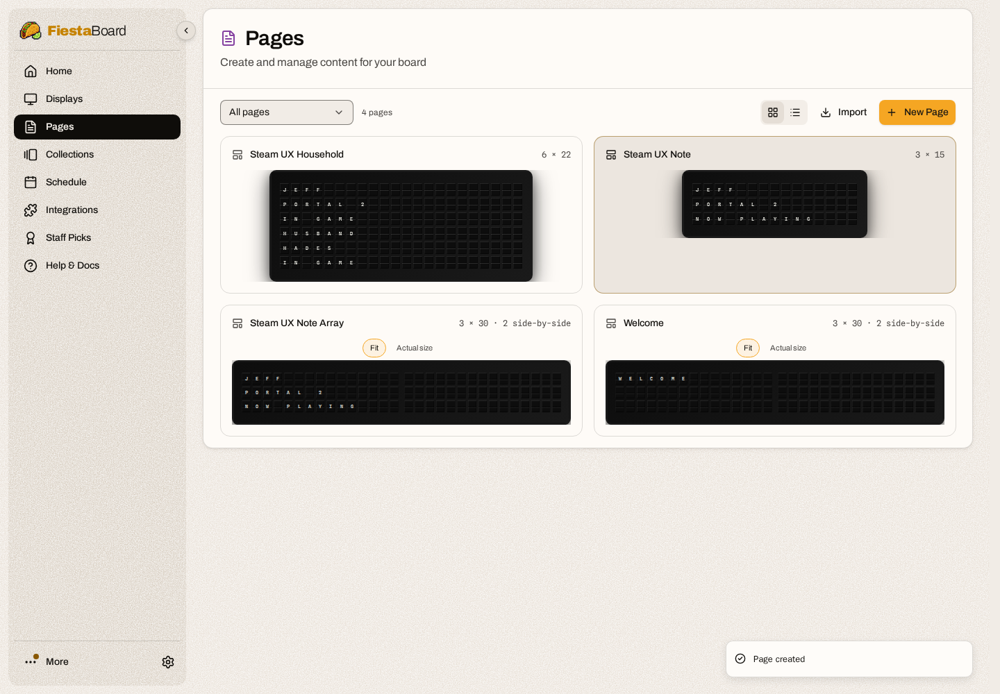

# Testing Steam for FiestaBoard

## Unit and core integration tests

Use Python 3.12 or later and a FiestaBoard checkout. The tests import the real
PluginBase, manifest validator, board context and template engine. Steam HTTP
responses are synthetic; no API key or Steam account is required.

```sh
python3 -m venv .venv
.venv/bin/pip install -r requirements-dev.txt requests jsonschema pydantic python-dotenv pyyaml regex pillow
FIESTABOARD_CORE=/absolute/path/to/FiestaBoard .venv/bin/python -m pytest \
  --cov=steam_plugin --cov=steam_api --cov-report=term-missing --cov-fail-under=80
```

When the checkouts are siblings named `FiestaBoard` and
`fiestaboard-plugin--steam`, the core path is automatic. CI installs the core's
full requirements and runs the same tests against its default branch.

Coverage includes URL validation, vanity resolution, credentials in headers,
timeouts, error redaction, expiry and failure cooldown, two independent
profiles, profile edits, friends batches larger than 100, private and omitted
data, hidden hours, malformed responses, incomplete achievement totals,
unknown unlock dates, current versus featured games, markup injection,
manifest validation, household templates and six board geometries.

## Actual browser UX with fixture Steam responses

`tests/ux/run_fixture_app.py` runs the real FiestaBoard API and built web UI,
loads this plugin, and replaces only outbound Steam HTTP with deterministic
responses. Run it in a **disposable container**. It requires `/app/src` and
`/app/web/build/client` from a compatible FiestaBoard checkout/build. It does
not run the normal display service or send content to hardware.

Build a FiestaBoard image from that checkout, or use a locally built compatible
image. Set the paths below to your checkouts; the web build must already exist
when mounting a local build over the image.

```sh
export STEAM_PLUGIN_ROOT=/absolute/path/to/fiestaboard-plugin--steam
export STEAM_CORE_ROOT=/absolute/path/to/FiestaBoard
docker build -t fiestaboard-steam-test "$STEAM_CORE_ROOT"
mkdir -p "$STEAM_PLUGIN_ROOT/test-results"
docker run -d --name fiestaboard-steam-ux \
  -p 127.0.0.1:18420:8000 --entrypoint python \
  -e FIESTABOARD_AUTH_ENABLED=false \
  -e FIESTABOARD_DATA_DIR=/tmp/steam-ux-data \
  -e PYTHONDONTWRITEBYTECODE=1 \
  -v "$STEAM_PLUGIN_ROOT:/app/plugins/steam:ro" \
  fiestaboard-steam-test /app/plugins/steam/tests/ux/run_fixture_app.py
```

Open `http://127.0.0.1:18420`. Skip display setup. The synthetic profiles are
`76561198000000001` (Jeff, Portal 2) and `76561198000000002` (Husband, Hades).
Use `fixture-key` as the API key. `invalid-test-key` simulates a rejected key;
`private-test-key` simulates a private friends list. **Never enter real keys in
this fixture app.** The transport accepts other keys too; it never validates
them against Steam.

The repeatable browser script starts with a fresh browser, dismisses onboarding,
creates `me` and `husband` through the UI, fills settings, checks key masking,
enables both, checks distinct stats, exercises errors, uses the variable picker,
and creates pages in the real editor. It refuses to run without the fixture
marker. It replaces those two fixture instances and creates test pages, so use
only the disposable app.

```sh
docker run -d --name fiestaboard-steam-browser \
  --network container:fiestaboard-steam-ux \
  -v "$STEAM_PLUGIN_ROOT/test-results:/results" \
  -v "$STEAM_PLUGIN_ROOT/tests/ux:/tests:ro" \
  mcr.microsoft.com/playwright:v1.64.1-noble tail -f /dev/null
docker exec fiestaboard-steam-browser npm install --prefix /tmp/harness \
  playwright@1.64.1 --no-audit --no-fund
docker exec \
  -e PLAYWRIGHT_MODULE=/tmp/harness/node_modules/playwright/index.mjs \
  fiestaboard-steam-browser node /tests/smoke.mjs
```

Screenshots and `report.json` are written to ignored `test-results/`. Review the
screenshots as well as the assertions. If restarting the app container, restart
the browser container too so it shares the current network namespace. To test
local core changes, mount its `src` and `web/build/client` read-only at those
same paths in `/app`.

Clean up only these disposable containers after testing:

```sh
docker rm -f fiestaboard-steam-browser fiestaboard-steam-ux
```

## Verification scope

The initial implementation passed 50 tests with 94.72% statement coverage.
It also passed the suite against a clean FiestaBoard 10.3.0 checkout. Browser
testing uses Chromium and the actual FiestaBoard UI/API with synthetic Steam
responses. The independent code review covered instance isolation, cache
expiry, privacy fallbacks, achievement completeness and board rendering.

All eight browser smoke checks passed: two-profile setup, visible validation
and correction, rejected-key response, private-friends fallback, variable
selection, household page, 3 × 15 Note and 3 × 30 Note Array. The saved pages
were checked through the rendering API and visually in the browser.



No authenticated live Steam test has been performed. Before relying on your
own pages, configure your real installation, check both profiles against Steam,
and confirm the privacy settings expose the data you want. A successful fixture
test cannot establish what Valve will expose for a particular account or game.
Physical display output is not part of this harness.
